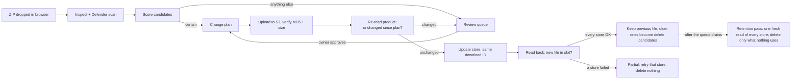

# 02: Plan (ShelfSync, the design)

| | |
|---|---|
| **Phase** | 1, Diagnosis and plan. Draft 3 was **APPROVED** 2026-10-25. This is **Draft 4, APPROVED 2026-10-25 with Phase 2**: the same design, corrected after the 2026-10-25 independent review and the owner's later decisions (TecHaust look, NSIS, offline signing key, Defender scan, `shelf_sync`) |
| **Date** | 2026-10-25 |
| **Published** | https://claude.ai/artifact/9CYLJk6kRPncuJ3Lmunn5f (Draft 4, with the ShelfSync look, P3.6, 2026-10-26). Built by `docs/02-plan-appendix/build_plan_page.py` from `plan-page.src.html`, and republished to this URL after every later change. The old Draft 3 link (CTnoFQTnUCMe91emHkEzyg) is in the owner's previous Claude organization and isn't updated |
| **Detailed in** | [03 PRD](03-prd.md) · [04 architecture](04-architecture.md) ([04-A verification](04-architecture-appendix/A-stack-verification.md)) · [05 design](05-design-system.md) · [06 security](06-security.md) · [07 testing](07-testing.md) · [08 roadmap](08-roadmap.md) · [13 content](13-content.md) |

> **In one line:** a browser app on the owner's own PC that takes a vendor ZIP, works out which product it belongs to, and updates every WooCommerce store from one S3 file. No AI, no silent guesses, nothing to pay for (the one exception, under a cent of AWS request charges, is in §11).

## 1. What ShelfSync is
- A **localhost-only** browser app for **one user on Windows**.
- The owner drops vendor ZIPs (WordPress themes and plugins) into the page. ShelfSync identifies the product, scans the ZIP with Windows Defender, uploads one file to S3, and updates the download on every WooCommerce store (today GPLFamily and PluginWay).
- **No AI is needed to run it.** A desktop icon starts it, a tray icon keeps it running, and one `Setup.exe` (NSIS) installs it.
- Folder and GitHub repo: **`shelf_sync`** (https://github.com/techaust/shelf_sync, created 2026-10-26; public during development, [11](11-decisions.md)). Product name: **ShelfSync**, "ShelfSync by TecHaust" ([05](05-design-system.md)).

## 2. The catalog and linked twins
A **catalog item** is one real product, for example "JupiterX – Website Builder". It holds:
- **Store links:** the product ID on each store (GPLFamily 1294, PluginWay 1373).
- **Download slots** (§3), each keeping its WooCommerce download ID on every store.
- **A canonical slug.** It starts as the product's shared URL slug (`jupiterx-website-builder-for-wordpress-woocommerce`), and the owner can shorten it (`jupiterx`). Every S3 file is named `<slug>-<version>.zip`, so a bad old attachment can never decide a file name again. If that name already exists with different content, the new file gets `-r2`, `-r3`, …; an existing object is **never overwritten**, so rollback always works.
- **Fingerprints:** what a matching ZIP looks like inside: type, folder slug, `Theme Name` / `Plugin Name`, text domain, author, Theme/Plugin URI.
- **History:** every version applied, with MD5, S3 object, who approved it (owner or auto-rule) and when, plus the previous file kept for rollback.

**Building it on first run** (read-only):
1. **Same product URL slug** on every store links twins: 2395 of 2398 today.
2. **Near-identical slug plus the same title** is offered as a one-click suggestion, never linked silently (the other 3, [01-A §2](01-audit-appendix/A-store-data-checks.md)).

SKU isn't used (no product has one). Anything that doesn't link cleanly goes to **Cleanup**: a twin missing on one store, duplicate products, an attached file that doesn't fit, stale metadata such as `latest_version_js-composer-theme`.

**Staying in step:**
- Every 15 minutes, and again just before any change, ShelfSync fetches only products changed since the last check (`modified_after`, sent as GMT with `dates_are_gmt=true`; WooCommerce 5.8+).
- `modified_after` never returns deleted or trashed products, so the **nightly snapshot also lists every product ID** (including trash) and compares: a missing or trashed product shows in Cleanup.
- A new product, a deleted product, or a download changed by hand shows in Cleanup as "changed outside ShelfSync", with one-click **accept** or **restore**.
- **Stores that are paused** are skipped by updates. Their products show "out of step" until the store is resumed and caught up. A **new store** starts with every product unlinked until its linking run, so updates are held until then.

## 3. Products with several files
Only **2 products per store** have more than one download today, so the rule can be strict.
- Every product has a **main slot** (button `Download`) and may have **extra slots**, each with its own name, canonical slug and fingerprint.
- A ZIP whose **main item** matches an extra slot's fingerprint updates that slot.
- A ZIP that carries items for **its own product's** extra slots can fill them, but only where the slot's fingerprint was confirmed before (ticked rows in the change plan).
- Bundled items **never touch a different product** (owner decision).
- A new extra slot is named from the item's header ("Jupiter X Core") and can be renamed.

## 4. Matching without AI
"Smart" means fixed rules, scores and reasons on screen, plus memory of every decision.

**Step 1, inspect the ZIP and find the main item**
- Unpack nested ZIPs within the limits ([06 §4](06-security.md)).
- Find installables: themes (`style.css` with `Theme Name`) and plugins (a `.php` file **at the root of a plugin folder** with `Plugin Name` in its first 8 KB, WordPress's own rule).
- Recognise vendor packages. The **main item is the top-level theme or plugin**. Items under `plugins/`, `includes/plugins/`, `inc/plugins/` or a TGM folder (editable list) are bundled. A child theme (`Template:`) is never chosen over its parent.
- **Version:** from the main item's header. A readme `Stable tag`, `package.json` or the filename are cross-checks. A **disagreement** is two numeric versions that differ. `trunk`, a missing tag, or a readme tag older than the header is not a disagreement (vendors often leave old readmes). A disagreement sends the ZIP to Review with both shown.
- **Version comparison** follows WordPress/PHP `version_compare` rules.
- **Version family jump:** the first number goes down, or goes up by more than 1 (7.9 → 4.62, 2.x → 5.x). 3.9 → 4.0 is normal.

**Step 2, score the candidates**

| Signal | Effect |
|---|---|
| Confirmed fingerprint for this slot (folder slug + header name + author) | **certain** |
| The owner approved this exact filename for this slot before | **certain** |
| Type differs (theme ZIP vs plugin product) | **ruled out** |
| Edition word differs (editable list: `pro`, `premium`, `plus`, `ultimate`, `extended`, `addon`/`add-on`, `lite`, `free`, `core`, `child`) | **never auto** and a penalty, never ruled out ("WPForms Pro" ZIPs often contain a plugin named just "WPForms") |
| Header name ≈ product title (word match; vendor prefixes and edition words removed) | strong + |
| Folder slug ≈ product URL slug | strong + |
| Author / URI matches what this product had before | + |
| Version continues the product's history | + |
| Version family jump | −, and **never auto** |

Weights and band cut-offs are **set from the calibration run** (§5) and ship with every version.

**Step 3, decide by band**

| Band | When | What happens |
|---|---|---|
| **Certain** | Confirmed fingerprint or approved filename, linked on every active store, version goes up, no guard raised | Applied automatically, once the trust ramp is passed ([07 §6](07-testing.md)) |
| **Likely** | One clear winner, not confirmed before | Review with the winner pre-selected; approving saves the fingerprint |
| **Unsure** | Several close candidates | Review with the top 3 and their reasons |
| **No match** | Nothing plausible | Review with search, or paste the product URL |

**Always held for review, even when certain:** a downgrade; the same version with different content; a version disagreement; a version family jump; not linked on every active store; the slot's current file fails the attachment check; changed outside ShelfSync since the last check; **a Windows Defender detection, or a scan that couldn't run**.

**Learning and unlearning:** each fingerprint shows its source ("confirmed by you on 25 Oct", "learned from current file"); one click removes a wrong one, and its past matches are listed.

## 5. Proving the matcher before it goes live
The S3 bucket is a ready-made test set (2398 objects, 12.5 GiB):
1. **Calibration (M4, on this PC, with the owner's go-ahead):** every file goes through the matcher **cold** (no learned fingerprints) with its filename hidden. The expected answer is the product it's attached to. Files the attachment check flags are set aside, and the owner reviews that exclusion list. **The bar: 0 wrong products in Certain**, and every known bad case ([01 §3](01-audit.md)) correct.
2. **What that proves, honestly:** 0 wrong in about 2,400 files means the true error rate in Certain is below about 0.13 % (95 % confidence), **on today's files**. New vendor versions can behave differently, which is why the trust ramp exists.
3. **Teach from current files (first run, optional, on by default):** each product's current file is inspected and its fingerprint saved as "learned from current file", only where the attachment check passes. This recovers what OmniSync's 42 hand-written overrides and aliases did, from the stores' own data.

Both read only what they need from each ZIP (HTTP range reads, [01-A §4](01-audit-appendix/A-store-data-checks.md) for the size and cost estimate). Calibration uses a **read-only S3 key** ([06 §5](06-security.md)).

## 6. Applying changes safely

- **Change plan first:** the S3 file and each store's slot from current to new, shown before anything is touched.
- **Edit check:** the product is re-read right before writing; if it changed after the plan, the job goes back to Review.
- **Customers keep their downloads:** the file is replaced inside the **same WooCommerce download ID**; other slots are untouched.
- **Read-back check** after each store update.
- **Partial is visible:** a failed store shows **partial** with Retry; nothing is deleted.
- **Safe delete:** an older file is deleted only after a fresh read of every store, **paused ones included** (and products in trash), finds nothing still pointing at it, variation downloads included. Files ShelfSync didn't upload are never deleted automatically; they're offered in Cleanup.
- **Rollback:** the previous file stays in S3; one click points every store back at it, after checking the file is still there.
- **Metadata:** `latest_version` set per product; stale `latest_version_<old-slug>` keys removed, or emptied if the REST API can't remove them (checked at M5, [04-A V4](04-architecture-appendix/A-stack-verification.md)).
- **Crash-safe:** each step is recorded in SQLite before and after it runs; after a restart, finished steps are skipped.
- **Brake:** auto-apply pauses and alerts after 3 failures in a row, or after more auto-applies in 10 minutes than the limit (default 30). A batch of 50 Certain ZIPs therefore pauses at 31 **on purpose**; one click continues. "Pause everything" is always on screen.
- **Nightly snapshot** (02:00 local time; run on wake if the PC was off or asleep) of every product's slots and version fields; "Restore this product to date X" works even for outside changes.
- **Gentle on the stores:** requests spaced (default 0.15 s); 429, 5xx and Cloudflare 520–527 retried with backoff; a store that keeps failing is paused.

## 7. Screens and daily use
Eight screens (**Dashboard, Upload, Review, Catalog, Product detail, Cleanup, Activity, Settings**), plus the first-run wizard, the tray menu and notifications. Requirements per screen: [03 §4](03-prd.md); wording: [13](13-content.md).
- Every match has **"Why?"**: the signals and points in plain words.
- **Keyboard-first Review:** `A` approve, `1`–`3` pick, `U` paste URL, `D` discard, `J`/`K` next/previous.
- **Windows notifications** when Review needs the owner or a job goes partial; clicking one opens that screen.
- **First-run wizard:** stores → storage → test → build catalog → Cleanup → teach from current files.

## 8. Look and feel
ShelfSync is a **TecHaust product**: TecHaust's Patina tokens (ink, verdigris, stone) with three app-bar additions; Archivo + IBM Plex Mono; the diagonal-cut device; a **new ShelfSync logo and asset set** in the same style. Store colours only as small identifiers (shape + dot + code). Rules: [05](05-design-system.md). The Draft 3 look (Manrope, store colours throughout) is retired.

## 9. Settings, security, build, install
- **Settings:** Stores, Storage, Rules, Updates, Backup, App ([03 §6](03-prd.md)).
- **Security:** `127.0.0.1` only, a per-install token that never appears in a URL (a single-use ticket is exchanged for a strict session cookie), `Host`/`Origin` checks, secrets in Windows Credential Manager, passphrase-encrypted backups, least-privilege keys, Defender scan of every ZIP, signed updates ([06](06-security.md)).
- **Built with:** Python 3.12 + FastAPI + SQLite + an in-process job worker; React + TypeScript (Vite); server-sent events for live progress ([04](04-architecture.md)).
- **Install:** one per-user `Setup.exe` built with **NSIS** (free, zlib licence), with the official Python runtime embedded (its executables are signed by the Python Software Foundation). No admin prompt.
- **The warnings money would remove:** `Setup.exe` isn't code-signed, so Windows SmartScreen warns **each time a newly downloaded copy is opened** ("More info → Run anyway"). In-app updates are downloaded by the app, so they show no warning. If **Smart App Control** were on, Windows could block the installer with no override; it's **Off** on this PC (owner, 2026-10-25) and is re-checked on the clean account at M1b. A paid code-signing certificate would remove both. **Optional, not used.**
- **Updates in the app:** download, verify the signature made with the owner's offline key, install beside the current version, switch, and switch back automatically if the health check fails.

## 10. Milestones and time
Phase 3 (brand and screens, about 4 days), then M1–M7, **about 24 build days**. That's 3 more than Draft 3, after the review found unplanned work ([08](08-roadmap.md)). **Nothing writes to the live stores before M6.**

## 11. Running cost
| Item | Cost |
|---|---|
| Python, FastAPI, React, SQLite, NSIS, LocalWP, moto, Playwright, Windows Defender | $0 |
| GitHub repo (public during development: Actions on standard runners free and unlimited, branch protection free; if made private again: 2,000 min/month, Windows runners count 2×, no branch protection), Releases, Dependabot | $0 |
| Code-signing certificate | not used (optional; would remove the SmartScreen/Smart App Control warnings) |
| AWS for calibration and teaching | $0 for data (inside the free 100 GB/month); **under one US cent** in request charges, possibly covered by the free tier |
| Day-to-day S3 and WooCommerce use | same as today |

## 12. Scorecard
Draft 3 claimed 10 on every aspect before any code; the 2026-10-25 independent review showed that was overclaimed. "Now" is after this draft's fixes. A 10 means **no known gap in the design**; a lower score names what's still open. The real proof is each milestone's exit test.

| Aspect | Draft 3 claimed | Now | Still open |
|---|---|---|---|
| Diagnosis | 10 | 9.5 | The UDesign case is recorded from OmniSync's log (the owner may add detail, optional); how the bucket's 2398 objects map to the downloads (M4 prep). Evidence with file:line in [01-B](01-audit-appendix/B-omnisync-evidence.md) |
| Catalog and linking | 10 | 9.5 | Store counts re-measured 2026-10-25 (identical, [01-A](01-audit-appendix/A-store-data-checks.md)); linking and the near-miss suggestions are proven by the M3 catalog build |
| Safety when applying | 10 | 9.5 | Meta removal and keeping the download ID proven on the test stack (M3, M5) |
| Usable without AI | 10 | 10 | — |
| Look and feel | 10 | 9 | Scored after Phase 3 (approved 2026-10-26): the real Windows tray, File Explorer and NSIS at 150/200 % (M1); axe and a screen reader on the React screens (M1a onward) |
| Matching logic | 10 | 9.5 | Cut-offs come from calibration (M4) |
| Security | 10 | 9.5 | All review findings fixed by 2026-10-25 (the last four, detection discard-only, retention as a writer, real-time protection, the reference rule, await one more re-check). Unproven until their milestone: real-time protection on this PC (V31, M1a), the M5 `security-review` of `apply/`. Residual risks named in [06 §10](06-security.md) |
| Install and updates | 10* | 9.5 | AppUserModelID via NSIS and the clean-account install (M1b) |
| Testing | 10 | 9.5 | Untested until their milestone: keeping the download ID (V3, M3), the S3 extension with moto (V6, M2), moto's coverage (V8, M2); the Windows checks layer runs from M1a |
| Scope and time | 10 | 9.5 | M1 is the riskiest estimate; the M6 length depends on how many ZIPs the owner processes |
| Multi-file products | 10 | 9.5 | How the bucket's objects map to the extra downloads (M4 prep) |
| Starting clean | 10 | 10 | — |

\* Within the no-paid-tools rule.
