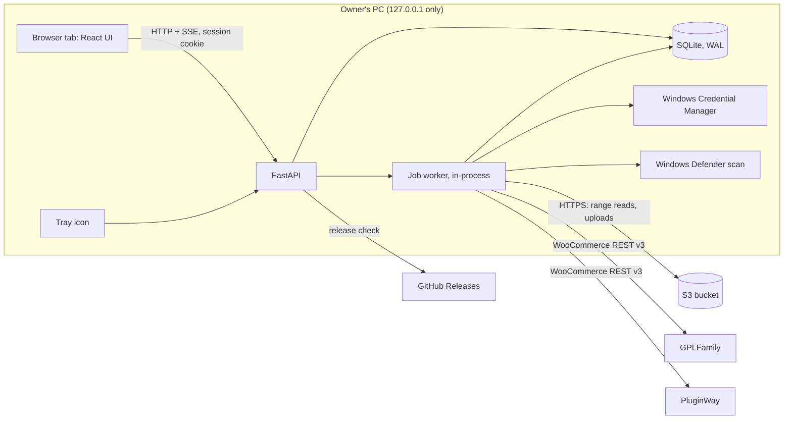
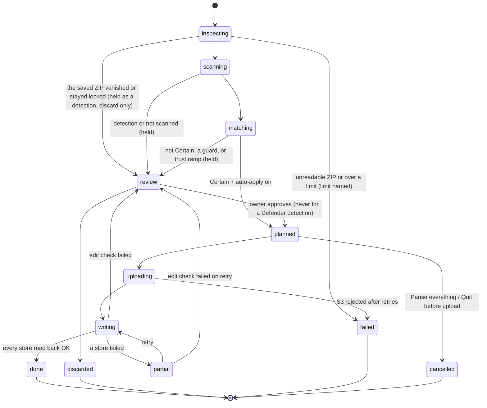

# 04: Architecture

| | |
|---|---|
| **Phase** | 2, Project documentation (**approved by the owner 2026-10-25**); corrected after the 2026-10-25 independent review |
| **Date** | 2026-10-25 |
| **Implements** | [03 PRD](03-prd.md) · ADRs [0001](adr/0001-python-fastapi-sqlite-react.md), [0002](adr/0002-embedded-python-nsis.md), [0003](adr/0003-catalog-linked-by-slug.md), [0004](adr/0004-rule-based-matching.md), [0005](adr/0005-localhost-only.md) |
| **Verification** | Every library and platform claim here has a status and source in [04-A](04-architecture-appendix/A-stack-verification.md) (V1–V31). Claims marked "to verify" there are treated as unknown here |

> **Versions.** Library choices are fixed here; exact versions are pinned at M1a after a Context7 check of each library's current release ([09 §3](09-tooling.md)), and recorded in §2 then.

## 1. The shape of it

One Python process holds the web server, the job worker and the tray. No separate services, no Docker at run time.

## 2. Stack

| Layer | Choice | Why |
|---|---|---|
| Runtime | **Python 3.12**, the official Windows embeddable package (PSF-signed executables, V12) with `python312._pth` edited to add `Lib\site-packages`, the app folder and `import site` (V11) | No PyInstaller-style unsigned program ([ADR 0002](adr/0002-embedded-python-nsis.md)) |
| Web | **FastAPI** on **uvicorn** (bound to `127.0.0.1`), **python-multipart** for uploads | Typed routes; OpenAPI generates the UI's TypeScript types (**openapi-typescript**) |
| Database | **SQLite** through the standard `sqlite3` module, WAL mode, numbered SQL migrations with a small runner, foreign keys on | One file, no ORM |
| HTTP | **httpx** (stores, GitHub), **boto3** (S3; `request_checksum_calculation="when_required"` for non-AWS endpoints, V10) | boto3 handles range reads, presigning and `ContentMD5` |
| ZIP over HTTP | Python `zipfile` on a small **seekable range-reader** (our own class over boto3 range GETs, with a block cache); filename encoding: UTF-8 flag honoured, cp437 otherwise | Reads the central directory and single entries without downloading whole files |
| Secrets | **keyring** (Credential Manager, V20) | [06 §3](06-security.md) |
| Crypto | **cryptography** (AES-256-GCM, Ed25519 verify); key derivation with the standard library's **`hashlib.scrypt`** (`maxmem=256 MiB`, V21; cryptography's Scrypt has no `maxmem`) | Backup export, update signatures |
| Tray | **pystray** + **Pillow** (V13) | Tray icon, menu, states |
| Notifications | **windows-toasts** (V14), Start-menu shortcut with an AppUserModelID | Toasts with a click callback (pystray has none) |
| UI | **React** + **TypeScript** + **Vite**, React Router, TanStack Query, **Tailwind v4** theme generated from `brand/tokens.json`, **Radix UI** primitives (Toast included), **Lucide** icons, virtualised tables (**TanStack Virtual**) | Same approach as the TecHaust admin ([05](05-design-system.md)) |
| Fonts | Archivo + IBM Plex Mono, self-hosted woff2 | NFR-1: works offline |
| Python quality | **ruff**, **mypy** (strict on `match/`, `apply/`, `inspect/`, `secure/`), **pytest** + **pytest-cov**, **hypothesis**, **respx**, **moto** (server mode for the test stack), **bandit**, **pip-audit**; dependencies locked with hashes by **uv** | CI gates ([07](07-testing.md)) |
| UI quality | **Biome**, `tsc --noEmit`, **Vitest**, **Playwright** + **@axe-core/playwright** (from M1a), `npm audit` | Same as TecHaust |
| Installer | **NSIS** (zlib licence, V15) | Per-user, no admin, no fee |
| CI | **GitHub Actions**: lint and tests on Linux runners; the Windows installer build only on release tags (Windows minutes count 2×, V23) | Stays inside the free 2,000 minutes |
| Windows-only parts | Credential Manager (keyring), toasts (windows-toasts), the tray's win32 backend, the `current` junction, the HKCU Run value and the Defender scan each sit behind a **small interface** with a real Windows adapter and a fake. Windows-only packages carry `sys_platform == "win32"` markers in the uv lock (V29) | Linux CI tests the logic against the fakes; the real adapters are proven by the **Windows checks** on this PC ([07 §1](07-testing.md)) |

## 3. Folder structure
```text
shelf_sync/
├─ backend/shelfsync/
│  ├─ api/          routes: session, jobs, review, catalog, cleanup, activity, settings, events (SSE), health, wizard
│  ├─ inspect/      range reader, zip walk, safe reader, header parsers, main-item rules, versions, Defender scan
│  ├─ match/        signals, scoring, bands, guards, fingerprints, calibration
│  ├─ apply/        change plan, s3, woocommerce client, read-back, rollback, restore, brake, retention
│  ├─ catalog/      twin linking, incremental sync, ID listing, slots, attachment check, cleanup, snapshots
│  ├─ jobs/         persistent queue, worker, step log
│  ├─ db/           schema, migrations/NNNN_name.sql, runner, backups
│  ├─ secure/       token, sign-in ticket + session, Host/Origin middleware, keyring, backup crypto, log redaction
│  ├─ tray/         tray icon, menu, toasts, launcher, single instance, start with Windows
│  ├─ platform/     interfaces + Windows adapters + fakes (keyring, toasts, junction, Run value, the Defender process
│  │                runner; the Defender output parser is a pure function in inspect/, CI-tested on recorded outputs)
│  └─ update/       release check, signature verify, side-by-side install, switch, health rollback
├─ frontend/        React + TypeScript UI (src/screens, src/components, src/api)
├─ brand/           logo geometry (source), generated assets, tokens.json
├─ packaging/       NSIS script, embedded-Python build script, ._pth template
├─ testenv/         one-command LocalWP + moto test stack (scripts, fixtures)
├─ tests/           unit, property, fuzz, contract, integration, calibration, performance, e2e
├─ tools/           research scripts, heavy.sh, watch.sh, model-guard.mjs, model-audit.mjs, release signing
├─ docs/            this documentation
└─ .github/workflows/  checks, build-release
```

## 4. Data model (SQLite)
Times are UTC ISO-8601 text. Versions are stored as the original string plus a sort key. Foreign keys are enforced; deletes are soft where history depends on the row.

| Table | Key columns | Notes |
|---|---|---|
| `store` | id, name, url, code, color, shape, spacing_ms, main_button, wc_version, state (`active`, `paused`) | Secrets in Credential Manager, keyed by store id |
| `store_product` | store_id, wc_id, slug, title, type, status, modified_gmt, raw_json, seen_at | Mirror of the store; unique (store_id, wc_id); index on (store_id, slug) |
| `catalog_item` | id, canonical_slug (unique), title, type, created_at | One real product |
| `item_link` | catalog_item_id → catalog_item, store_id → store, wc_id | Unique (store_id, wc_id). "Linked on every active store" = one row for each store whose state is `active` |
| `slot` | id, catalog_item_id, name, slug, is_main | |
| `slot_download` | slot_id, store_id, wc_download_id, file_url | Kept across updates (APL-04) |
| `fingerprint` | **id**, slot_id, type, folder, header_name, author, text_domain, uri, source (`confirmed`, `learned`), created_at, removed_at | MAT-09/10 |
| `approved_filename` | id, slot_id, filename (unique per slot) | MAT-03 |
| `file` | id, slot_id, s3_key (unique), version, version_key, md5, size, origin (`uploaded`: by ShelfSync; `found`: already in the bucket), created_at, deleted_at | History, rollback, `-r2` naming. Only `uploaded` files are ever deleted automatically (APL-07) |
| `object_ref` | s3_key, store_id, wc_id, wc_download_id, product_status, seen_at | Every download on every store (active or paused, any status including trash) that points at an S3 object, **variation** downloads included. **A download points at an object** when its file field contains the object's key in any form: the shortcode, a direct or presigned S3 URL, or URL-encoded (on 2026-10-25 all 2400 download links on each store were the `[amazon_s3 ...]` shortcode); anything ShelfSync can't parse counts as a reference, so it's never deleted; rebuilt by the nightly snapshot, which reads downloads with `include_status=any,trash` (incremental sync never returns trash, V1). One key can have many rows (shared files). The safe-delete check (APL-07) re-reads the stores, not just this table |
| `job` | id, filename, md5, size, state, band, catalog_item_id, slot_id, plan_json, scan_result, error, attempt, created_at, updated_at | States in §6; index on state |
| `job_step` | job_id, seq, kind, target, state, started_at, finished_at, detail_json | Crash-safe log (APL-10) |
| `candidate` | job_id, slot_id, score, reasons_json, rank | "Why?" |
| `decision` | job_id, action, by (`owner`, `auto`), at, matched_proposal (bool) | Also feeds the trust ramp |
| `issue` | id, kind, catalog_item_id, detail_json, state (`open`, `fixed`, `dismissed`), suggested_fix_json | Cleanup |
| `activity` | id, at, what, store_id, before, after, by, job_id | UI-ACT; index on at |
| `snapshot` | id, taken_at, store_id, wc_id, status, slots_json, meta_json | SYNC-03/04, APL-14; the only place snapshots live |
| `trust_ramp` | count, last_reset_at | APL-13 |
| `setting` | key, value_json | All settings except secrets |
| `wizard` | step, state_json | UI-WIZ resume |
| `schema_migration` | version, applied_at | SYS-07 |

## 5. API (FastAPI, JSON; access control in [06 §2](06-security.md))

| Area | Endpoints (prefix `/api`) |
|---|---|
| Session | `POST /session/ticket` (launcher only: install token in an `Authorization` header, single-use 60 s ticket out; refused if an `Origin` is present, [06 §2](06-security.md)), `POST /session` (exchanges the ticket for the session cookie), `POST /session/reset-token` |
| Health | `GET /health` (no session; returns only `{"app":"shelfsync","version":…}`) |
| Events | `GET /events` (SSE: job progress, counts, health; uses the cookie) |
| Jobs | `POST /jobs` (multipart, many files), `GET /jobs`, `GET /jobs/{id}`, `POST /jobs/{id}/retry`, `POST /jobs/{id}/cancel`, `POST /pause`, `POST /resume` |
| Review | `GET /review`, `POST /review/{job}/approve`, `…/pick`, `…/paste-url`, `…/discard`, `…/apply-anyway`, `POST /review/bulk-approve` |
| Catalog | `GET /catalog?q=&filter=`, `GET /catalog/{id}`, `PATCH /catalog/{id}` (slug), `GET /catalog/{id}/snapshots`, `DELETE /fingerprints/{id}`, `POST /catalog/{id}/rollback`, `…/restore`, `…/set-file`, `GET /catalog.csv` |
| Sync | `POST /sync` (sync now), `POST /teach` (teach from current files) |
| Cleanup | `GET /cleanup`, `POST /cleanup/{id}/apply`, `POST /cleanup/{id}/dismiss`, `POST /cleanup/link-pair`, `POST /cleanup/apply-suggested` |
| Activity | `GET /activity?q=&from=&to=&filter=`, `GET /activity.csv` |
| Settings | `GET/PUT /settings/{group}`, `POST /stores`, `PATCH /stores/{id}` (pause, edit), `DELETE /stores/{id}`, `POST /stores/{id}/test`, `POST /storage/test`, `PUT /secrets/{name}` (write-only), `POST /backup/export`, `POST /backup/import` |
| Wizard | `GET /wizard`, `PUT /wizard/{step}` |
| Updates | `GET /updates`, `POST /updates/install`, `POST /updates/rollback` |

Writes that touch a store or S3 never run inside a request: the request creates or advances a job, and the worker does the work.

## 6. Job lifecycle

- **Held** = in `review` because of a guard (it shows the reason).
- **Before inspecting**, the worker checks that the saved ZIP still exists and opens; a lock is retried for up to 5 s (the scanner, the indexer or a closing handle can hold it briefly). A file that is gone, or still locked after the retries, is held as a detection (INS-06), because real-time protection is the likely cause (V31).
- **One job writes at a time.** Inspection and scanning of later files run ahead in a pool of 2 threads (the PC has 2 cores).
- Each step writes a `job_step` row before (`started`) and after (`done`/`failed`). On start-up, a `started` step is resumed by **checking the real state first** (S3 HEAD, product read) rather than repeating blindly.
- **Rollback and restore** plans `head_object` every file they would point a store at; a missing file blocks the job before any store write (APL-08, APL-14).
- **Retention** runs once per pass, after the job queue drains (not after every job), as a **job that holds the single writer slot**, so no rollback, restore or Set file manually can run between its read and its deletes. Candidates that a queued rollback, restore or Set file manually would point at are left out. In the pass, **one** fresh read of every store (active and paused, including trash, and the **variations** of every variable product) covers all pending delete candidates; an object is deleted only if nothing points at it and its `file.origin` is `uploaded`; otherwise the skip and its reason are logged. If any store's read fails or is partial, nothing is deleted in that pass (APL-07). A pass costs about one catalog read per store (about 25 pages at 0.15 s spacing), whatever the batch size, plus one request per variable product (none today, V30).

## 7. Talking to the outside
- **WooCommerce** (5.8+): REST v3 over HTTPS with the store's consumer key and secret. Downloads are updated by sending the product's full `downloads` array, keeping the existing `id` for the changed slot (V3, proven at M3). Sync uses `modified_after` + `dates_are_gmt=true` (V1); the nightly snapshot reads every product's full `downloads` with `include_status=any,trash` (and would read variations too, though neither store has any today, V30), and its ID listing uses `_fields=id,status` (the minimum WooCommerce version for `include_status` is checked at M3, V28). Spacing, retries and backoff per APL-12.
- **S3:** single `put_object` with `ContentMD5`; `head_object` to verify size (V9). **Range reads:** read the last 64 KB to find the End of Central Directory record (and the ZIP64 locator if present), then read the central directory at its stated offset (it can be larger than 64 KB), then the local header and data of each needed entry. An inner ZIP stored uncompressed is read the same way; one stored compressed is downloaded whole. Download links come from the template setting (today `[amazon_s3 object="{key}"]`).
- **Windows Defender:** `"%ProgramFiles%\Windows Defender\MpCmdRun.exe" -Scan -ScanType 3 -File <zip> -DisableRemediation`, output parsed for a detection, 120 s timeout (V19, INS-06).
- **GitHub Releases:** read-only check with the owner's fine-grained token (private repo).

## 8. Packaging, install and updates
- **Build (CI, Windows, on a release tag):** download the Python 3.12 embeddable package (SHA-256 pinned), check its executables' signatures, write `python312._pth`, install the app's wheels with `pip install --target Lib\site-packages` from the hash-locked requirements, add the built UI, then compile `ShelfSync-Setup.exe` with NSIS. The build produces an **unsigned** release manifest; the owner signs it offline ([06 §6](06-security.md), runbook `release.md`).
- **Install layout (per user, no admin):**
  - program: `%LOCALAPPDATA%\Programs\ShelfSync\versions\<version>\`
  - a **directory junction** `%LOCALAPPDATA%\Programs\ShelfSync\current` → the active version (junctions need no admin)
  - data: `%LOCALAPPDATA%\ShelfSync\` (database, `backups\`, `logs\`, `tmp\`, `runtime.json`)
  - shortcuts (desktop, Start menu with an AppUserModelID) and the Start-with-Windows value all run `%LOCALAPPDATA%\Programs\ShelfSync\current\pythonw.exe -m shelfsync.launcher`, a path that never changes
- **Launcher:** reads `runtime.json` (port, PID). If `GET /api/health` doesn't answer, it starts the server and tray first. It then sends the install token (from Credential Manager) to `POST /api/session/ticket` and opens `http://127.0.0.1:<port>/#t=<ticket>`. The ticket is single-use and expires after 60 s, so the install token itself never reaches the address bar, browser history or the browser's command line. The page exchanges the ticket for the session cookie and removes it from the address bar. A toast click does the same.
- **Updates:** download in the app → verify signature and checksums → unpack into a new `versions\<v>` → back up and migrate the database → re-point `current` → restart → health check; on failure, re-point back automatically. One previous version is kept for "Roll back app"; older ones are deleted. "Roll back app" keeps the data when the update didn't change the database layout; if it did, it restores the backup taken before the migration (SYS-07), after warning that changes made since the update are lost (owner, 2026-10-26).
- **Uninstall:** NSIS removes `%LOCALAPPDATA%\Programs\ShelfSync` entirely (every version, the junction, shortcuts, the Run value), and `%LOCALAPPDATA%\ShelfSync` only if "remove my data" is ticked.
- **Honest note:** compiled parts of some wheels (`cryptography`, `pydantic-core`) are DLLs their projects don't sign. The M1b exit test runs on a clean account with Defender on and records the Smart App Control state (V18).

## 9. Configuration, ports, logs, time
- **Settings** live in the `setting` table; secrets in Credential Manager; `runtime.json` holds only the current port and PID.
- **Port:** default **47615**; if taken, the next free one up to 47624, saved to `runtime.json` (SET-06).
- **Logs:** `%LOCALAPPDATA%\ShelfSync\logs\shelfsync.log`, JSON lines (UTC time, level, job ID, step, message), rotated daily, kept 30 days, secrets redacted (LOG-01).
- **Temp:** `%LOCALAPPDATA%\ShelfSync\tmp\<job>`, removed after each job and at start-up.
- **Database backups:** daily SQLite online backup, 7 kept, plus one before each migration (BAK-01).
- **Time:** UTC everywhere inside; shown in Windows local time with the zone name; schedules (sync, 02:00 snapshot) in local time (NFR-8).

## 10. Environments

| Environment | Stores | S3 | Used for |
|---|---|---|---|
| Unit / contract | Recorded responses | Stubbed (botocore Stubber) | Every commit in CI |
| **Local test stack** (`testenv/`) | LocalWP WordPress + WooCommerce + the owner's **Amazon S3 Storage** extension set to a "User defined" endpoint (V6) | **moto server** (V7, V8) | Every store write is proven here first (M2 setup, M5 writes). If the extension can't use moto, real downloads are proven only in the canary, and the tests prove the stored shortcode |
| Calibration | Live stores, **read-only** | Live bucket, **range reads with the read-only key** | M4, with the owner's go-ahead |
| Live canary | Both live stores, **one product** the owner picks | Live bucket | M6, each step with the owner's yes |
| Live | Both stores | Live bucket | After M6 |
