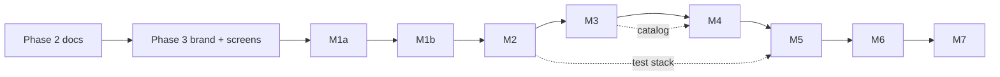

# 08: Roadmap (phases, milestones and approval gates)

| | |
|---|---|
| **Phase** | 4, Build. Phases 1–3 approved (2026-10-25, 2026-10-25, 2026-10-26). **M1a approved 2026-10-27** (PRs #7–#9, and #12 for the Quit fix found in its exit test). **M1b code done 2026-10-28** (#13, #15–#18, and #20 for the Settings screens); its exit test is the owner's ([runbooks/m1b-exit-test.md](runbooks/m1b-exit-test.md)). **M2 started 2026-10-28:** plan in [runs/m2.0-plan.md](runs/m2.0-plan.md); M2.1 to M2.5b merged (#19, #22–#24, #26, #27). Next: M2.6 docs; M2.7 S3 and M2.8 test stack wait for the owner's package yes; then the M2 exit test |
| **Date** | 2026-10-25; status line updated 2026-10-27 |
| **Rule** | Each phase and milestone ends with a short summary to the owner and **waits for "approved"** before the next starts. Nothing writes to the live stores before M6 |
| **Traceability** | Every PRD ID has its milestone in the **M** column of [03](03-prd.md). The lists below are copied from there |

## How a milestone works
1. Brief per task in `docs/runs/<task>.md` with its tier ([12 §2](12-models-and-usage.md)); Tier A briefs are drafted by the `analyst`.
2. `builder` (backend) → Tier A early check → `designer` (screens) → `reviewer` → fixes → re-check ([12 §4](12-models-and-usage.md)).
3. The skills in [09 §3](09-tooling.md) are loaded automatically.
4. The lead integrates, runs the full checks, and shows the owner the result and the exit test; it waits for "approved".
5. [10-status](10-status.md) and [11-decisions](11-decisions.md) are updated.

## Phase 1: Diagnosis and plan ✅ approved 2026-10-25
[01 audit](01-audit.md) and [02 plan](02-plan.md) (Draft 3; Draft 4 approved with Phase 2 on 2026-10-25).

## Phase 2: Project documentation ✅ approved 2026-10-25
Docs 01–13, the appendices, ADRs 0001–0008, runbooks, `CLAUDE.md`, the agent files and session skills. **Exit:** the owner approves the set (changes first, if any).

## Phase 3: Brand and screens ✅ approved 2026-10-26 (designer at high effort, Tier A for effort)
| Step | What | Exit |
|---|---|---|
| P3.0 | Check whether the built-in browser works inside an agent ([12 §4](12-models-and-usage.md)) | Recorded in 11 |
| P3.1 | **Logo concepts:** three ShelfSync concepts ([05 §1.2](05-design-system.md)), each as the symbol at 16/32/64 px, the primary lockup in light and dark, and the tray icon on a taskbar | The owner picks one (lead at high, 12 §3) |
| P3.2 | **Refine and audit** (pixel fitting, spacing, contrast), scored with reasons in `docs/14-brand-audit.md` | The owner approves the refined logo |
| P3.3 | **Brand pipeline and assets:** the geometry file and generator in `brand/` (the `designer` builds it, choosing its dev-only libraries with the owner's yes), all assets in [05 §1.4](05-design-system.md) | Every file present; geometry and contrast tests pass |
| P3.4 | **Mockups** of the 8 screens, the wizard and the empty/error states, built from the tokens | Self-checked against 05 |
| P3.5 | **16 screenshots** (8 × light/dark) plus extras, sent to the owner; mockup published as an artifact | The owner approves the screens |
| P3.6 | Republish the plan with the new look | Done 2026-10-26 at a new link, recorded in 02 (the old one is in another Claude organization, [11](11-decisions.md)) |

If the owner asks for changes at any step: update the docs, the mockups and the screenshots, then ask again.

## Phase 4: Build (about 24 build days)
| | Milestone | Days | PRD IDs | Exit test |
|---|---|---|---|---|
| **M1a** (approved 2026-10-27) | Skeleton and security base | 2 | **Create the `shelf_sync` repo (owner's yes; done 2026-10-26, public during development)**, CI, tokens and fonts, UI-SHELL (shell), UI-TRAY, SYS-02, SYS-03, SYS-04, SET-06 (logic; its screen, UI-SET App, is M1b), ERR-06, LOG-01, NFR-1, NFR-5, NFR-8; token → single-use ticket → session, Host/Origin/CSRF, CSP ([06 §9](06-security.md)), the Windows checks layer ([07 §1](07-testing.md)); axe in CI | The empty app runs from the tray; the security checks for M1a pass; axe clean |
| **M1b** (code done 2026-10-28; exit test pending) | Installer and updater | 3.5 (owner, 2026-10-27) | SYS-01, SYS-06, SYS-07, SYS-08, SET-04, UI-SET (Updates, App); offline signing (`release.md`) | Installs on the second clean account with Defender on (Smart App Control state recorded); updates itself from a signed test release and refuses a tampered one; uninstall leaves no program folder |
| **M2** (started 2026-10-28; M2.1–M2.5b merged by 2026-10-29: stores, backups, storage settings, export and import, and their screens; S3 and the test stack wait for the owner's package yes) | Settings, secrets, test stack | 3 | SET-01, SET-02, SET-05, UI-SET (Stores, Storage, Backup), UI-HELP (guides), BAK-01, ERR-01, ERR-03; store and S3 secrets in Credential Manager (the adapter arrives in M1a.2), both IAM policies, LocalWP + moto | The two stores (read test only), S3 (both keys) and the test stack all test green |
| **M3** | Catalog and Cleanup (read-only on live) | 4 | CAT-01–05, CAT-07, CAT-08, SYNC-01–05, APL-12, UI-CAT (read-only), UI-PRD (read-only), UI-CLN, UI-WIZ (to catalog), ERR-02, ERR-07 (no stores, Cleanup); the first live **reads** (owner's go-ahead) | Every shared slug linked; the 3 near misses suggested; every issue listed with a reason; a trashed test-stack product found |
| **M4** | Inspect, scan, match, calibrate | 5 | CAT-06, CAT-07 (file mismatch), INS-01–06, MAT-01–09, UI-WIZ (teach step); calibration (§3 of [07](07-testing.md)) | 0 wrong products in Certain on the owner-reviewed set; every known bad case correct; EICAR held; calibration report shared |
| **M5** | Review, plans, writes on the test stack | 4 | MAT-07 (screens), MAT-10, APL-01–11, APL-13 (logic), APL-14, APL-15, CAT-04 (naming), SYNC-02 (restore), UI-SHELL (live counts), UI-DSH, UI-UPL, UI-REV, UI-PRD (actions), UI-ACT, UI-HELP, UI-SET (Rules), SET-03, SYS-05, ERR-04, ERR-05, ERR-07 (Review, Activity), NFR-3, NFR-4 | The whole end-to-end suite passes against the test stack; performance targets met |
| **M6** | Live canary and trust ramp | 2 + the ramp | APL-13 (live); the canary ([07 §5](07-testing.md)), each step approved | Canary, test download and rollback verified on both stores; 50 Certain ZIPs in a row agree |
| **M7** | Finish | 2 | UI-CAT (CSV), UI-ACT (CSV); NVDA pass; user guide; README; full `security-review` | One week of real use: 0 wrong products applied, 0 partial jobs left open over a day, every job in Activity, no terminal needed. Then OmniSync can be retired |

**Cross-cutting from M1a, checked at every milestone:** NFR-2 (accessibility), NFR-6 ($0), NFR-7 (plain, maintainable parts).

**Honest estimates:**
- **M1 (both parts) is the riskiest**: embedded Python, NSIS, the junction-based updater and the clean-account test are all new. If M1a and M1b together run over 5 days, the lead says so and re-plans with the owner. M1a took 2 days (2026-10-26 to 2026-10-27), on its estimate. M1b is planned at about 3.5 days with the Python 3.14 move, so M1 runs just over 5 days; the owner accepted this on 2026-10-27, and the lead re-plans with the owner if M1b's day 3 ends without the exit test.
- **The trust ramp's length depends on volume.** At the owner's usual rate of N ZIPs a day, of which about 70 % are Certain (to be measured in M4), 50 takes about 50 / (0.7 × N) days. At 10 a day that's about a week.
- **Total: about 24 build days** plus Phase 3's 4 days and the ramp, about 5–6 weeks at a normal pace. M1–M3 are shown to the owner before matching starts, so the direction can still change cheaply.

## Dependency view

